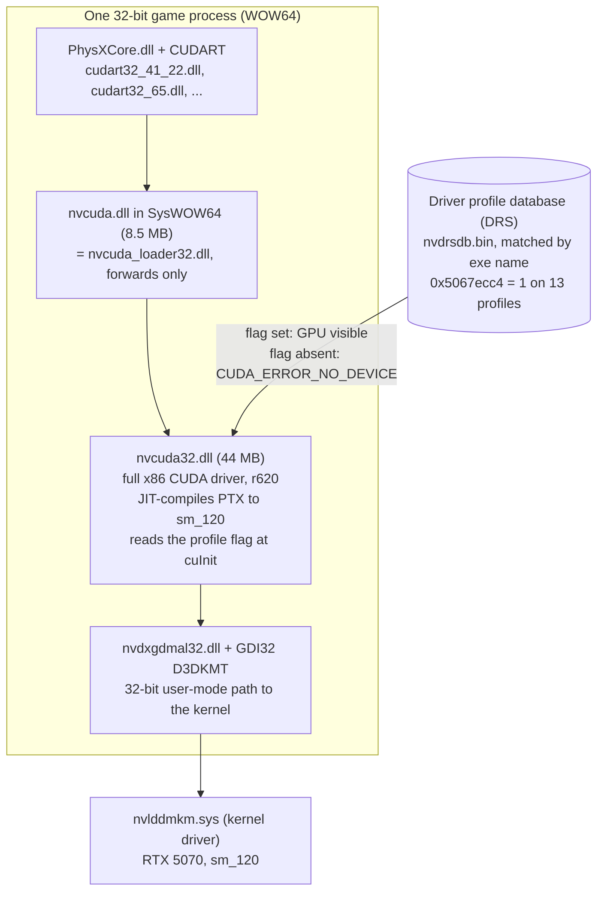
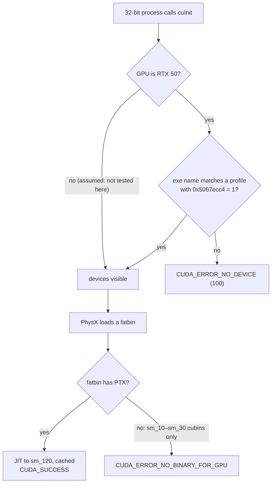
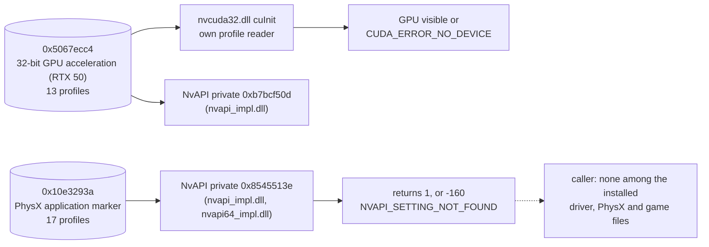
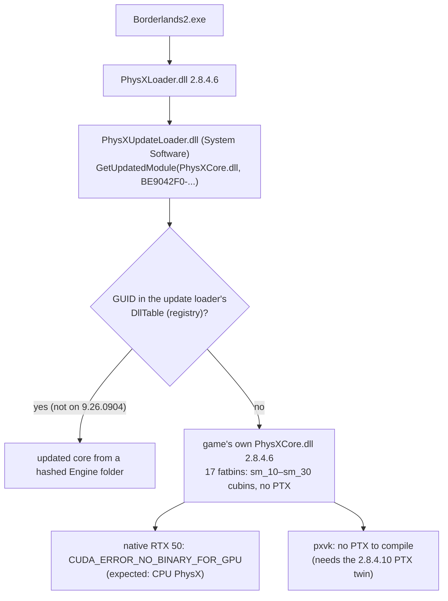

# NVIDIA's 32-bit PhysX on RTX 50

How NVIDIA's driver brings 32-bit GPU PhysX back on RTX 50 cards, what it
covers, and what that means for pxvk. Measured on the development machine on
30 October 2026 with small test programs; the real games were not run.

## Summary

NVIDIA never removed 32-bit CUDA from the driver. Driver 621.01 still ships a
full 32-bit CUDA driver (`nvcuda32.dll`, 44 MB) that runs inside the game's
own 32-bit process and talks to the GPU directly. On an RTX 50 GPU it simply
reports "no device" unless the game's driver profile carries one
undocumented setting, `0x5067ecc4 = 1`.

- **No 64-bit translation layer.** There is no 64-bit helper process and no
  thunking of calls to 64 bits: device pointers are real 32-bit addresses.
- **Per-architecture.** The 32-bit driver JIT-compiles PTX for sm_120 itself.
  Every new GPU generation needs NVIDIA to keep building a 32-bit driver and
  JIT that know it, so whether a 60-series keeps 32-bit PhysX is NVIDIA's
  choice again, and dropping it is possible.
- **The allow-list is policy, not capability.** The same test program gets
  the GPU when renamed `borderlands2.exe` and "no device" under its own name.
- **Cubin-only runtimes still fail.** Inside an allowed process, all 17 of
  Borderlands 2's bundled PhysX modules (sm_10–sm_30 machine code, no PTX)
  are refused with `CUDA_ERROR_NO_BINARY_FOR_GPU`. Runtimes carrying PTX
  load fine.

pxvk depends on none of this: it replaces `nvcuda.dll` in the game process
and compiles PTX to SPIR-V on any Vulkan device. Like NVIDIA's driver, it
needs PTX.

## Setup and method

| Item | Value |
|---|---|
| GPU | NVIDIA GeForce RTX 5070 Laptop GPU (sm_120), plus an Intel iGPU |
| Driver | 621.01 (file version 32.0.16.2101, branch `r620_97`), package `nvlti.inf_amd64_360580ba71c61256` |
| PhysX System Software | 9.26.0904 |
| Game | Borderlands 2 (Steam): bundled `PhysXCore.dll` 2.8.4.6 |
| Comparison runtime | System Software PhysX 2.8.4.10 (`Engine\6FE164B5308A`) |

Methods:

1. Inventoried the driver package and read the strings, imports and PDB
   paths of its 32-bit CUDA DLLs.
2. Wrote small 32-bit test programs that call the CUDA driver API directly.
   Each was run under its own name and under game executable names.
3. Dumped all 8,045 driver application profiles (DRS) read-only through
   NvAPI's `NvAPI_DRS_*` calls.
4. Loaded every PhysX fatbin from both runtimes through `cuModuleLoadData`
   and through CUDART's private module loader, from an allowed process name.

"Reproducing" below gives the details.

## The 32-bit CUDA driver

The 32-bit driver is a native in-process driver, not a bridge to 64 bits.

What the evidence shows:

- **A forwarding loader.** `SysWOW64\nvcuda.dll` is byte-identical to the
  package's `nvcuda_loader32.dll`. It imports only Kernel32 and Advapi32,
  and its only DLL names are `nvcuda32.dll` and `NVCUDA64.DLL`.
- **A full x86 build.** `nvcuda32.dll` has the PDB path
  `gpgpu\cuda\_out\wddm2_x86_release\nvcuda.pdb` from branch `r620_97`, the
  same build as `nvcuda64.dll`. It imports only Windows DLLs (Version,
  Kernel32, Advapi32, GDI32, Shlwapi, User32).
- **In-process.** After `cuCtxCreate` the test process has loaded
  `nvcuda32.dll`, `nvdxgdmal32.dll` and NvAPI (`nvapi.dll`,
  `nvapi_impl.dll`), and has no child process. `cuMemAlloc` returns 32-bit
  device pointers (`0x26800000`, `0x27800000`, `0x29800000`, ...), and
  unified addressing is off.
- **Its own JIT.** The package also ships `nvptxJitCompiler32.dll` (26 MB)
  and `nvvm32.dll` (61 MB). The first PTX load of a 2.8.4.10 module takes
  60–580 ms; a second run takes 0.3–1 ms, so JIT results are cached.
- **Legacy-specific code.** Strings include "Api expected legacy context with
  32 bit device pointers" and "Loading 64-bit device binary on 32-bit host
  process is not supported", and two sources under
  `gpgpu\cuda\legacy32\src\syscalls\texemu\` (`texemu_core.cu`,
  `tex_bcx.cu`): a texture emulator written in CUDA.
- **Texture routines for new GPUs.** The package's `nvcubins.bin` (74 MB) is
  the driver's library of device-side code (device runtime, printf, malloc,
  syscalls): 266 cubins for sm_75 through sm_121, with 916 distinct
  functions. 282 of them have texture or surface names, including sm_120/121 builds of
  `__cuda_syscall_bw_*` texture routines. The file is shared by the 32- and
  64-bit drivers, and linking it to 32-bit PhysX's texture use is an
  inference, not tested.

Files in the driver package relevant here:

| File | Size | Role |
|---|---|---|
| `nvcuda_loader32.dll` | 8.5 MB | installed as `SysWOW64\nvcuda.dll`; loads `nvcuda32.dll` |
| `nvcuda32.dll` | 44 MB | the 32-bit CUDA driver |
| `nvptxJitCompiler32.dll` | 26 MB | 32-bit PTX JIT compiler |
| `nvvm32.dll` | 61 MB | 32-bit NVVM |
| `nvdxgdmal32.dll` | 0.5 MB | 32-bit kernel-interface layer, loaded at context creation |
| `nvcubins.bin` | 74 MB | device-side library cubins (sm_75 – sm_121), shared with 64-bit |
| `nvdrsdb.bin` | – | default application profiles, copied to `ProgramData\NVIDIA Corporation\Drs` |

## The allow-list

The gate is DRS setting `0x5067ecc4`, which NVIDIA Profile Inspector names
"PhysX - Enable 32-bits GPU Acceleration (RTX 50)" (minimum driver 591.44,
[name list][npi-csn]). It is set to 1 on exactly 13 of the driver's 8,045
application profiles. Those 13 are NVIDIA's nine announced titles,
Batman: Arkham Asylum (announced for 2026), and two extras: Just Cause 2
(which uses CUDA for water, not PhysX) and QQ Dance. Profiles match by
executable name, so renaming any 32-bit program to a listed name gives it
the GPU. NVIDIA describes the feature as individual profiles for
hand-picked titles ([PCWorld, 5 December 2025][pcworld]).

| Profile | Executables in the profile | `cuInit` under that name |
|---|---|---|
| Alice: Madness Returns | alicegame.exe, shippingpc-alicegame.exe, alicemadnessreturns.exe | not tested |
| Assassin's Creed IV: Black Flag (SP) | ac4bfsp.exe | not tested |
| Assassin's Creed IV: Black Flag (MP) | ac4bfmp.exe | not tested |
| Batman: Arkham Asylum | shippingpc-bmgame.exe, bmlauncher.exe, bmstartapp.exe | bmstartapp.exe: OK |
| Batman: Arkham City | batmanac.exe, batman-arkham-city.exe, bmgame.exe | not tested |
| Batman: Arkham Origins | batman0.exe, batmanoriginsonline.exe, batmanorigins.exe | not tested |
| Borderlands 2 | launcher.exe, borderlands2.exe, willowgame.exe, shippingpc-willowgame-pcconsole-lowgore.exe | borderlands2.exe, willowgame.exe: OK; launcher.exe: no device |
| Just Cause 2 | justcause2.exe, justcause2_f.exe, justcause2_r.exe, jcmplauncher.exe | justcause2.exe: OK |
| Mafia II | mafia2.exe, mafia2_sc.exe | mafia2.exe: OK |
| Metro 2033 | metro2033.exe, metro2033benchmark.exe | metro2033.exe: OK |
| Metro: Last Light | metroll.exe | not tested |
| Mirror's Edge | tdgame.exe, mirrorsedge.exe | tdgame.exe: OK |
| QQ Dance | qqdance.exe, qqx51_game.exe, qq.exe, tencentdl.exe and others | qqdance.exe: OK |

`launcher.exe` probably fails because several profiles claim that name
(Borderlands: The Pre-Sequel's too).

The game names appear nowhere in `nvcuda32.dll`; they are only in the
profile database (`nvdrsdb.bin` in the package, `nvdrsdb0.bin` and
`nvdrsdb1.bin` under `ProgramData\NVIDIA Corporation\Drs`).

`nvcuda32.dll` reads the flag itself during `cuInit`, through its own
profile reader (`0x100d6ea0` in this build), and keeps the result in a flag
byte. The older driver package still in the driver store (592.07, file
version 32.0.15.9207) has the same check, with the flag on 11 profiles.

## The second setting: a PhysX application marker

`0x10e3293a` marks GPU PhysX titles; it does not enable anything in CUDA.
NVIDIA Profile Inspector's reference list names it "Physx Enable", "Set for
PhysX applications" ([reference list][npi-ref]). It is set to 1 on 17
profiles:

- Cryostasis, Sacred 2, Dark Void, Darkest of Days and The Bureau: XCOM
  Declassified;
- Borderlands 2, Borderlands: The Pre-Sequel and Planetside 2;
- Batman: Arkham Asylum, City and Origins;
- Assassin's Creed IV (SP), Rogue and Freedom Cry;
- Mirror's Edge, Alice: Madness Returns and Mafia II.

What was measured:

- **Not a CUDA gate.** `cryostasis.exe`, `sacred2.exe`, `thebureau.exe` and
  `borderlandspresequel.exe` all get `CUDA_ERROR_NO_DEVICE`, and the CUDA
  driver never reads this setting.
- **One reader: a private NvAPI query.** Only `nvapi_impl.dll` and
  `nvapi64_impl.dll` refer to the ID (in 592.07, the unsplit `nvapi.dll` and
  `nvapi64.dll`). The function behind private interface `0x8545513e`
  allocates an `NVDRS_SETTING`, reads `0x10e3293a` for the current
  application and writes 1 to its single output argument when the value is
  1.
- **It answers per executable.** Called from a 32-bit test program,
  `0x8545513e` returns status 0 and value 1 as `cryostasis.exe`,
  `sacred2.exe`, `thebureau.exe`, `borderlandspresequel.exe`,
  `planetside2.exe`, `borderlands2.exe`, `tdgame.exe` and `mafia2.exe`. It
  returns `-160` (`NVAPI_SETTING_NOT_FOUND`) under its own name and as
  `justcause2.exe`, `metro2033.exe`, `metroll.exe` and `qqdance.exe`. Those
  have the CUDA flag but not the marker.
- **No caller found.** The ID also appears in `PhysXDevice.dll` (System
  Software 9.26.0904), `nvcuda32.dll`, `nvopencl32.dll`, NVML and other
  driver DLLs, three times each: NvAPI's statically linked wrapper for every
  interface. In `PhysXDevice.dll` that wrapper has no caller and nothing
  points to it; in `nvcuda32.dll` nothing calls it directly. The other DLLs
  were not disassembled. BL2's own `PhysXDevice.dll` and every PhysX runtime
  ask NvAPI only for private IDs `0x84244524` and `0xcb7b09d2`.

So `0x10e3293a` is NVIDIA's long-standing "this is a GPU PhysX title" tag,
readable through NvAPI. Nothing on this machine consumes it, so its effect
is unknown. Plausible consumers are tools that are not installed here, such
as the NVIDIA App. It is older than the RTX 50 change: 592.07 already had it
on the same 17 profiles. It is not the 32-bit restore list: Metro 2033,
Metro: Last Light and Just Cause 2 have the CUDA flag without the marker,
while Cryostasis, Sacred 2 and others have the marker without the flag.

## Kernels: PTX only, no translation of old machine code

The driver does not translate old cubins. In a process named
`borderlands2.exe`, every module of Borderlands 2's bundled PhysX core is
refused, through both load paths PhysX can use:

| Runtime | GPU code it ships | `cuModuleLoadData` | CUDART module loader |
|---|---|---|---|
| Borderlands 2's own core, PhysX 2.8.4.6 (`Special\Borderlands2` build, CUDA 4.1) | sm_10/11, sm_20, sm_30 cubins; no PTX | 0 of 17 (`CUDA_ERROR_NO_BINARY_FOR_GPU`) | 0 of 17 |
| System Software PhysX 2.8.4.10 | PTX plus sm_20–sm_52 cubins | 17 of 17 (PTX JIT) | 17 of 17 |

So on an RTX 50, GPU PhysX depends on the runtime carrying PTX. On a stock
install Borderlands 2 always uses its bundled core:

The loader asks the update loader for its own GUIDs (`BE9042F0-ADC4-4b12-
A93E-DB8A731FDBD5` for the core, `8F2594AC-F8B3-47f2-BDFC-86310FED9255` for
cooking), which 9.26.0904 does not register. The update loader then loads
the local DLL. Only if that fails does the loader try `PhysXCore.dll` on the
search path and then a version folder under the System Software's
`PhysXCore Path`, which does not exist (`docs/compatibility.md`).

As measured, native Borderlands 2 on an RTX 50 should therefore fall back to
CPU PhysX despite being on NVIDIA's list. Not confirmed by running the game:
its first launch failed on missing DirectX and VC++ redistributables, which
Steam installs on a first launch from the client. Listed games whose runtime
carries PTX should load their kernels; not checked game by game.

## What this means for pxvk

NVIDIA can drop 32-bit PhysX again on any new generation, because the
mechanism is per-architecture: there is no translation layer, just a 32-bit
driver.

- **What a new generation costs NVIDIA.** The 32-bit driver, its PTX JIT and
  any `legacy32` texture emulation must learn the new architecture, and be
  tested against these games, every generation. That is ongoing work for
  10–13 titles.
- **The restriction is a choice.** The full 32-bit driver already runs any
  32-bit CUDA program on Blackwell; the profile flag alone decides who gets
  it. Renaming an executable unlocks it. NVIDIA Profile Inspector already
  lists `0x5067ecc4` by name, so users can set it on any profile; whether
  that unlocks 32-bit CUDA for another program is untested.
- **Coverage is narrow even on the list.** A listed game whose bundled PhysX
  has no PTX, like Borderlands 2's, gets nothing from the driver change
  alone.

For pxvk:

- **Nothing to depend on.** NVIDIA's support covers 13 executables, on RTX 50
  only, and must be rebuilt for every GPU generation. pxvk covers every game
  using a supported runtime, on any Vulkan device, whatever NVIDIA ships
  next.
- **The same PTX limit.** Both compile PTX. A cubin-only runtime like
  Borderlands 2's needs a PTX source in pxvk too: the System Software's
  2.8.4.10 runtime matches all 105 of its kernels by name, parameter size and
  shared-memory size.
- **Behaviours worth copying.** The driver caches JIT results (pxvk already
  caches pipelines) and keys support on per-application profiles. A pxvk
  table of known runtimes could map cubin-only builds, such as Borderlands
  2's, to their PTX twins.

## Reproducing

All of this is read-only except the test programs' own files. Keep the
outputs in `tmp/` or `test-output/`: the driver's and games' files are
proprietary.

- **Allow-list test.** A 32-bit program (`i686-w64-mingw32-gcc`) that loads
  `nvcuda.dll`, calls `cuInit(0)`, then `cuDeviceGetCount`,
  `cuDeviceGetName` and `cuDeviceGetAttribute` (75/76 for the compute
  capability). Copy it to a folder under a game's executable name and run
  it there.
- **Module test.** The same program, run as `borderlands2.exe`, creates a
  context and passes every fatbin it finds in a `PhysXCore.dll` (magic
  `0xBA55ED50`) to `cuModuleLoadData`. For CUDART's path it calls
  `cuGetExportTable` with the CUDART interface GUID
  (`6bd5fb6c-5bf4-e74a-8987-d93912fd9df9`, as in `tools/nvcuda-trace`) and
  entry 1 of the table with a fatbin wrapper `{0x466243b1, 1, fatbin,
  NULL}`.
- **In-process check.** After `cuCtxCreate`, list the process's modules
  (`EnumProcessModules`) and child processes (Toolhelp snapshot), and print
  a few `cuMemAlloc` pointers.
- **Profile dump.** A 64-bit program loads `nvapi64.dll` and resolves
  functions through `nvapi_QueryInterface`:

  | Function | Interface ID |
  |---|---|
  | `NvAPI_Initialize` | `0x0150e828` |
  | `NvAPI_DRS_CreateSession` | `0x0694d52e` |
  | `NvAPI_DRS_LoadSettings` | `0x375dbd6b` |
  | `NvAPI_DRS_EnumProfiles` | `0xbc371ee0` |
  | `NvAPI_DRS_GetProfileInfo` | `0x61cd6fd6` |
  | `NvAPI_DRS_EnumApplications` | `0x7fa2173a` |
  | `NvAPI_DRS_EnumSettings` | `0xae3039da` |
  | `NvAPI_DRS_GetSettingNameFromId` | `0xd61cbe6e` |

  NvAPI's strings are 2048 UTF-16 units, so the version-1 structures are
  4116 bytes (profile), 12296 (application) and 12320 (setting); a wrong
  size returns `-9` (incompatible structure version). Undocumented setting
  IDs come back with unrelated display names, so compare IDs only.
- **Marker query.** A 32-bit program calls `NvAPI_Initialize` and then the
  private interface `0x8545513e` as `int f(unsigned *out)` (cdecl), under
  different executable names.
- **Finding readers.** Search binaries for the setting ID as a
  little-endian 32-bit value. In a disassembly the reads are `push
  <id>`; NvAPI's dispatch table in `nvapi_impl.dll` pairs each function
  address with its interface ID.

## Open questions

- [ ] Does native Borderlands 2 really fall back to CPU PhysX on RTX 50?
      Install its redistributables (one launch from Steam), set PhysX to
      High, and trace it with `tools/nvcuda-trace`.
- [ ] Is the gate RTX 50-only? Repeat the rename test on the RTX 3070
      laptop, where 32-bit CUDA is expected to work for any program.
- [ ] Does setting `0x5067ecc4` on a custom profile unlock 32-bit CUDA for
      any program? Untested: it changes a driver setting.
- [ ] What calls NvAPI `0x8545513e`, and so what the PhysX marker
      `0x10e3293a` changes? Search the NVIDIA App's files once installed.
- [ ] Do 32-bit kernels use the `texemu` code? A native trace of a
      texture-using PhysX kernel on RTX 50 would show it.

## Sources

- Measurements on the development machine, 30 October 2026: driver package
  `nvlti.inf_amd64_360580ba71c61256` (621.01) and the test programs above.
- [PCWorld: "Surprise! Nvidia brings PhysX back to GeForce RTX 50 GPUs (kind
  of)"][pcworld], 5 December 2025: the nine titles, Arkham Asylum for 2026,
  and the per-title profiles.
- [PC Gamer][pcgamer] and [TweakTown][tweaktown] coverage of driver 591.44
  (headlines only; full text not read).
- [NVIDIA Profile Inspector][npi]'s [`CustomSettingNames.xml`][npi-csn] and
  [`Reference.xml`][npi-ref]: community names for `0x5067ecc4` and
  `0x10e3293a`.

[pcworld]: https://www.pcworld.com/article/3002325/surprise-nvidia-brings-physx-back-to-geforce-rtx-50-gpus-kind-of.html
[pcgamer]: https://www.pcgamer.com/hardware/graphics-cards/in-a-surprise-change-of-heart-nvidias-brought-32-bit-physx-support-back-to-rtx-50-series-graphics-cards-though-only-for-a-select-number-of-games
[tweaktown]: https://tweaktown.com/news/109210/nvidia-restores-32-bit-physx-support-for-geforce-rtx-50-series-graphics-cards/index.html
[npi]: https://github.com/Orbmu2k/nvidiaProfileInspector
[npi-csn]: https://github.com/Orbmu2k/nvidiaProfileInspector/blob/master/nvidiaProfileInspector/CustomSettingNames.xml
[npi-ref]: https://github.com/Orbmu2k/nvidiaProfileInspector/blob/master/nvidiaProfileInspector/Reference.xml
